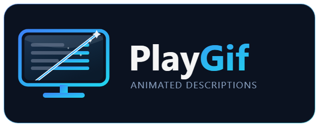

# PlayGif Playnite Extension

   

  

  

  

A Playnite extension that brings game descriptions to life. Instead of the static text panel, descriptions render through a real browser engine — so Steam store trailers, GIFs, animated WebP and AVIF all play inline, exactly as they look on the store page.

Designed for Desktop mode, with experimental Fullscreen support.

Built with the help of Claude Code

---

https://github.com/user-attachments/assets/90acd659-e195-446f-aeab-e5349ae84fd7

## What's New - v1.0.4

Includes everything from 1.0.3, which was not released on its own.

### New
- **Edit description.** Right-click a game → PlayGif → Edit description opens a visual editor where your GIFs and videos play while you edit. Insert media at the cursor from web search, a URL or a file, click any media to resize or remove it, and format text with headings, quotes, colour, alignment and lists. There's a raw HTML view too.
- **Keep your own descriptions.** Turn off *Replace descriptions that have no media with the store description* in Settings → General, and PlayGif leaves descriptions written by you or another extension (such as Metadata AI) alone. Games with no description are still filled in.
- **Video previews in web search.** MP4 and WebM results play in the picker, so you can see the clip before adding it.

### Fixed
- **Steam videos play for every game.** For some games (Cyberpunk 2077 and Valheim, for example) Steam's MP4 version is in a format the renderer can't play, so the video area stayed blank. PlayGif now spots these and switches to the other version Steam provides.
- **Your own description now wins.** If you, or another extension, change a game's description after PlayGif fetched one, the new description is what you see. Fetch, Edit and Reset description put PlayGif back in charge.
- **Fetching descriptions for many games at once no longer crashes Playnite.** It goes one game at a time with a progress bar you can cancel, and finishes with a single summary.
- **Preview description** works for every game, including ones with a `:` in the name.
- **Media added from web search no longer shows as an empty gap**, and Imgur `.gifv` links work.
- **Playnite no longer stays dimmed** after closing a PlayGif dialog.
- Quickly switching games no longer shows the previous game's description, links that open in a new tab go to your browser, and cancelling settings really discards your changes.

### Improved
- **Smoother scrolling.** Only the videos you can see play; the rest wait until you scroll to them.
- **"Refresh description" is now "Reset description"**, and asks before discarding cached media and edits.

### Previous Version
- **v1.0.2**: descriptions fetched in your language, **Convert cached media to MP4** and **Repair description links**, and a fix attempt for descriptions reverting to plain text after a restart.

---

## Features

- **Animated inline content** — video, GIF, animated WebP and AVIF, rendered by the WebView2 engine
- **Store descriptions** — pulls rich media descriptions from Steam and GOG when local metadata is plain text
- **Custom media** — add your own clips or images to the top or bottom of any description
- **Video sizing** — global scale and height cap, with per-game overrides
- **Offline cache** — media is cached locally with a per-game size limit
- **Resource-aware** — pauses playback when a game launches or Playnite loses focus
- **Theme compatible** — injects into the existing description panel, so themes keep their layout

---

## Requirements

- **Playnite 10** (SDK 6.16.0)
- **Windows 10 (2004 / May 2020 update) or newer**, or Windows 11
- **WebView2 Evergreen Runtime** — pre-installed on Windows 11 and most Windows 10 machines. If missing, get it from [Microsoft](https://developer.microsoft.com/en-us/microsoft-edge/webview2/)
- **FFmpeg** *(optional)* — needed for **Convert cached media to MP4**, and used to convert the store videos PlayGif falls back to WebM for into MP4. Everything still plays without it.

---

## Installation

1. Download the latest `.pext` from [Releases](https://github.com/aHuddini/PlayGif/releases)
2. Open Playnite → Add-ons → Extensions
3. Click **Add extension** and select the `.pext`
4. Restart Playnite

---

## Usage

Right-click any game for the **PlayGif** menu:

| Action | What it does |
|---|---|
| **Add media** | Insert a local file, a URL, or a web image search result at the top or bottom of the description |
| **Remove media** | Pick a media file to remove; it is stripped from the description too |
| **Edit description** | Opens the description in a WYSIWYG editor — media plays while you edit. Includes a raw HTML view |
| **Reset description** | Discards the cached description and all cached media, then re-fetches from the store. Cannot be undone |
| **Video scale** | Set 25/50/75% for this game, or reset to the global default |
| **Fetch description** | Pull a rich description from Steam or GOG |

Library-wide options live in **Settings → PlayGif → General**:

| Setting | What it does |
|---|---|
| **Fetch Steam descriptions for all games** | Bulk-fetches rich descriptions across your library |
| **Convert cached media to MP4** | Re-encodes cached GIFs and other animations with FFmpeg — much smaller, and hardware-decoded |
| **Repair description links** | Points descriptions at converted files, and clears links whose media is gone. Runs automatically after converting |

If descriptions do not render correctly in your theme, open **Settings → PlayGif → Theme Support** and run the layout report — it records what PlayGif found in your theme's panel, which is what a bug report needs.

---

## Known Issues

**Theme compatibility is the rough edge.** Playnite has no official support for animated descriptions, so PlayGif injects a renderer into whatever description panel your theme happens to build. Themes lay that out very differently, and other extensions modify it too.

What that can look like:

- Visual glitches — clipped text, blank gaps, content in the wrong place, or flicker while scrolling
- Descriptions that don't animate at all in a particular theme
- Problems that appear only when another extension is installed, because several also modify the details view (HowLongToBeat, achievements plugins, screenshot viewers, and others)

Reports are welcome. Some theme layouts may be out of reach, but a report helps identify which ones:

1. **Settings → PlayGif → Theme Support → Run layout report**
2. Open an [issue](https://github.com/aHuddini/PlayGif/issues) with the report, your theme name, and any other extensions that touch the details view

The long-term fix is official Playnite support for animated content in descriptions, which would remove the need to inject anything. Until then, per-theme patches go in the Theme Support tab as they're identified.

---

## Licensing and Dependencies

PlayGif is MIT licensed. All third-party dependencies use permissive licenses (MIT or BSD 3-Clause). See [THIRD-PARTY-NOTICES](THIRD-PARTY-NOTICES) for details.

### Codec and Media Licensing

**PlayGif ships no media codecs.** All decoding (H.264, VP8/VP9, AVIF, animated WebP, GIF) is handled by the WebView2 Evergreen Runtime — a system component installed and maintained by Microsoft. PlayGif bundles only the managed WebView2 API wrapper and native loader: no Chromium binaries, no codec libraries, no patent-encumbered components. Codec licensing (MPEG LA for H.264, etc.) is the runtime distributor's responsibility, not this extension's.

### Store APIs

PlayGif fetches descriptions from Steam's public store API (`store.steampowered.com/api/appdetails`) and GOG's product API — the same endpoints used by Playnite's own metadata plugins. No API key is required, and requests are rate-limited with retry logic.

---

## Support

- **Issues**: https://github.com/aHuddini/PlayGif/issues
